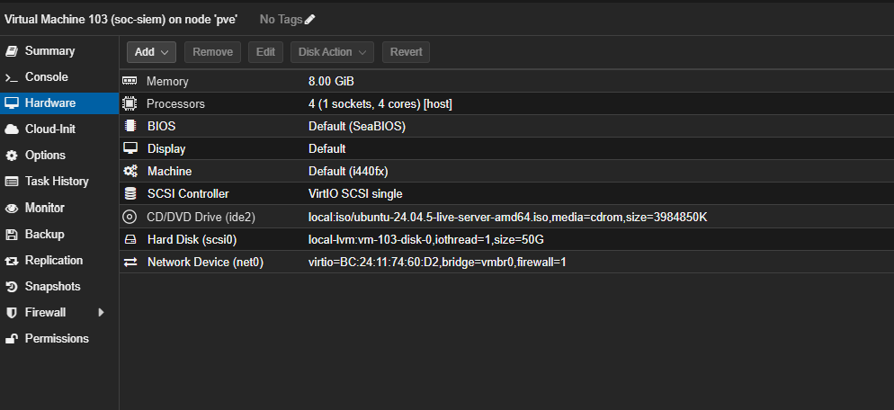

# Infrastructure Setup

## Overview

The SOC homelab is hosted on a Dell OptiPlex running Proxmox VE.

A dedicated virtual machine was created specifically for the Wazuh SIEM environment rather than installing the SIEM on one of the existing application servers.

Separating the SIEM from other workloads provides clearer resource allocation and makes the environment easier to manage and troubleshoot.

## Proxmox Host

The Proxmox host contains multiple existing workloads including:

- Jellyfin
- Docker-host
- Ubuntu-Lab
- SOC-SIEM

Before deploying Wazuh, the available system resources were checked to confirm that the host had enough memory and storage available.

The Proxmox host had approximately:

```text
15 GiB total RAM
11 GiB available RAM
```

Storage availability was also verified before creating the new virtual machine.

## SIEM Virtual Machine

A dedicated virtual machine called `soc-siem` was created.

| Setting | Value |
|---|---|
| VM ID | `103` |
| Hostname | `soc-siem` |
| Operating System | Ubuntu Server 24.04 LTS |
| CPU | 4 vCPU |
| Memory | 8 GB |
| Virtual Disk | 50 GB |
| Storage | local-lvm |
| Network Bridge | vmbr0 |
| Network Adapter | VirtIO |
| Static IP | `192.168.7.70/22` |
| Gateway | `192.168.4.1` |

The VM was configured with CPU type `host` so that the guest operating system could use the processor features available on the physical Proxmox host.

## Evidence

The following screenshot shows the virtual machine configuration inside Proxmox.



## Ubuntu Installation

Ubuntu Server 24.04 LTS was installed on the new virtual machine.

The system hostname was configured as:

```text
soc-siem
```

OpenSSH Server was also installed to allow the server to be administered remotely.

## Storage Issue

After installation, the virtual disk had been configured as 50 GB inside Proxmox.

However, checking the Ubuntu filesystem using:

```bash
df -h
```

showed that the root filesystem was only approximately:

```text
24 GB
```

This indicated that the entire virtual disk had not been allocated to the root logical volume.

## LVM Investigation

The available LVM space was checked using:

```bash
sudo vgs
```

The output showed approximately:

```text
24 GB VFree
```

This confirmed that around half of the virtual disk was still available inside the volume group.

## LVM Expansion

The root logical volume was expanded using:

```bash
sudo lvextend -l +100%FREE -r /dev/ubuntu-vg/ubuntu-lv
```

The `-r` option automatically resized the filesystem after extending the logical volume.

The final filesystem size was verified using:

```bash
df -h /
```

The root filesystem increased to approximately:

```text
48 GB
```

with around:

```text
39 GB
```

available before the Wazuh installation.

## Static Networking

The SIEM server originally received a DHCP address:

```text
192.168.7.202
```

A SIEM server should have a stable network address because monitored endpoints need a consistent address for communication.

The server was therefore configured with the static IP:

```text
192.168.7.70/22
```

The default gateway was configured as:

```text
192.168.4.1
```

The network interface used by Ubuntu was:

```text
ens18
```

## Connectivity Testing

After applying the static network configuration, connectivity was tested.

The local gateway was tested using:

```bash
ping -c 3 192.168.4.1
```

Internet connectivity was tested using:

```bash
ping -c 3 1.1.1.1
```

DNS resolution was tested using:

```bash
getent hosts packages.wazuh.com
```

All tests completed successfully.

## Final SIEM Infrastructure

At the end of the infrastructure stage, the SIEM server had:

```text
Hostname:    soc-siem
IP Address:  192.168.7.70/22
Gateway:     192.168.4.1
CPU:         4 vCPU
Memory:      8 GB
Storage:     approximately 48 GB usable root filesystem
```

## Skills Demonstrated

This stage of the project demonstrated practical experience with:

- Proxmox VE
- virtual machine provisioning
- Ubuntu Server
- Linux networking
- static IP configuration
- Linux LVM
- filesystem expansion
- SSH administration
- network troubleshooting
- infrastructure planning
