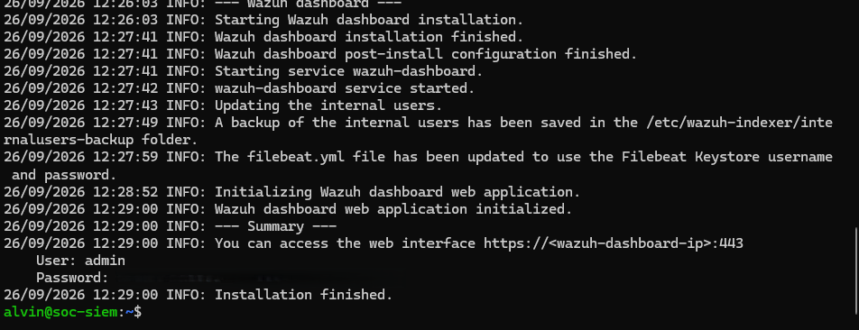
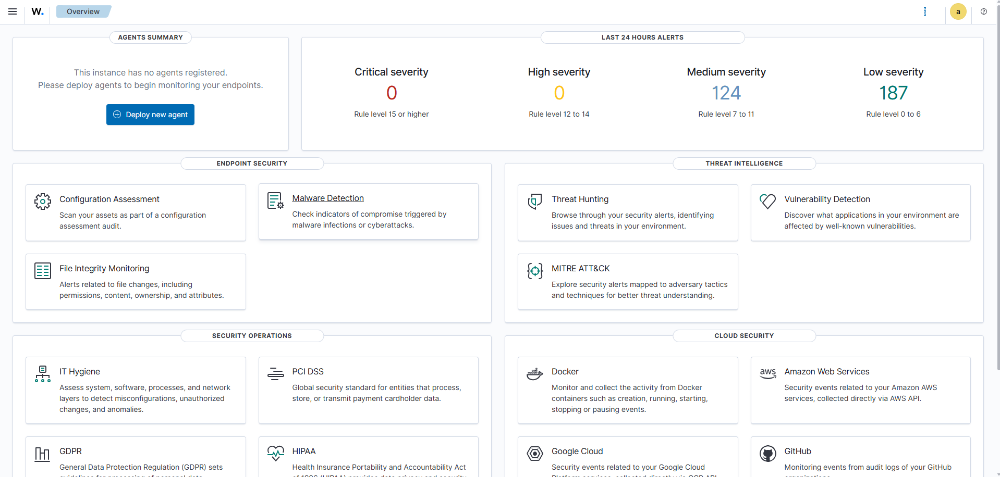

# Wazuh Installation

## Overview

After preparing the `soc-siem` virtual machine, I deployed Wazuh as the central SIEM platform for my lab.

I used an all-in-one installation so the Wazuh Manager, Indexer and Dashboard all run on the same server.

For a small homelab, this gives me a simple architecture while still allowing me to practise centralised monitoring and alert investigation.

## Wazuh Components

My installation contains three main Wazuh components:

| Component | Purpose |
|---|---|
| Wazuh Manager | Receives and analyses security telemetry |
| Wazuh Indexer | Stores and indexes alerts |
| Wazuh Dashboard | Interface I use to investigate security events |

## Preparing Ubuntu

Before installing Wazuh, I updated Ubuntu:

```bash
sudo apt update
sudo apt upgrade -y
```

I also installed the supporting packages I needed:

```bash
sudo apt install curl unzip ca-certificates -y
```

## Downloading Wazuh

I downloaded the Wazuh installation assistant using:

```bash
curl -sO https://packages.wazuh.com/4.14/wazuh-install.sh
```

I then started the all-in-one installation:

```bash
sudo bash ./wazuh-install.sh -a
```

This installed the manager, indexer and dashboard on `soc-siem`.

## Successful Installation

At the end of the installation, Wazuh reported that the deployment had completed successfully.

The installer also generated credentials for the administrator account.

I have deliberately not stored any passwords or credentials in this GitHub repository.

## Installation Evidence



## Service Verification

Rather than relying only on the installer output, I manually checked the three main services.

I ran:

```bash
systemctl is-active wazuh-manager wazuh-indexer wazuh-dashboard
```

The result was:

```text
active
active
active
```

This confirmed that all three components were running.

## HTTPS Verification

I also checked whether the dashboard was listening on HTTPS port 443:

```bash
sudo ss -tulpn | grep ':443'
```

The system showed a listener on:

```text
0.0.0.0:443
```

This confirmed that the dashboard web service was available over HTTPS.

## Dashboard Access

I access the Wazuh Dashboard internally using:

```text
https://192.168.7.70
```

Because the lab uses a self-signed certificate, my browser displays a certificate warning when I first connect.

I then authenticate using the Wazuh administrator account generated during installation.

## Initial Dashboard

Once installation was complete, I successfully accessed the dashboard.

At this stage, I had not yet onboarded any monitored endpoints.



The dashboard gives me access to functionality such as:

- Threat Hunting
- MITRE ATT&CK
- File Integrity Monitoring
- Vulnerability Detection
- Security Configuration Assessment
- endpoint inventory
- compliance monitoring

## Security Considerations

I do not store sensitive Wazuh information in the repository.

This includes:

- administrator passwords;
- private keys;
- API credentials;
- authentication tokens;
- sensitive certificate files.

## Result

At the end of this stage, I had a functioning central SIEM platform:

```text
                     soc-siem
                         |
         +---------------+---------------+
         |               |               |
         v               v               v
   Wazuh Manager   Wazuh Indexer   Wazuh Dashboard
```

My next step was to onboard an endpoint so I could begin collecting and analysing real host telemetry.

## What I Learned

This stage gave me practical experience with:

- SIEM deployment;
- Wazuh architecture;
- Linux package management;
- Linux services;
- HTTPS services;
- service verification;
- network port verification;
- secure credential handling.

I also learned that successful installation output is not enough on its own. I should independently verify that services are running and that the expected network ports are listening.
