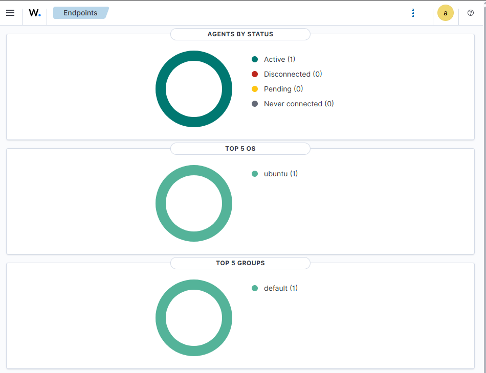

# Linux Endpoint Onboarding

## Overview

After deploying Wazuh, I onboarded my existing `ubuntu-lab` virtual machine as the first monitored endpoint.

My objective was to establish centralised monitoring and confirm that the endpoint could successfully send telemetry to the Wazuh Manager.

## Endpoint Details

| Setting | Value |
|---|---|
| Hostname | `ubuntu-lab` |
| IP Address | `192.168.7.164` |
| Operating System | Ubuntu Linux |
| Wazuh Agent ID | `001` |
| Wazuh Manager | `192.168.7.70` |
| Agent Group | default |

## Agent Deployment

I used the Wazuh Dashboard to generate the Linux agent installation command.

I configured the agent to communicate with:

```text
192.168.7.70
```

which is the static IP address of my `soc-siem` server.

After installing the agent, I started and enabled the Wazuh Agent service.

## Service Verification

I checked the local service using:

```bash
systemctl is-active wazuh-agent
```

The result was:

```text
active
```

This confirmed that the agent was running on `ubuntu-lab`.

## Agent Logs

I reviewed the local Wazuh logs using:

```bash
sudo tail -n 30 /var/ossec/logs/ossec.log
```

The logs showed several monitoring components starting successfully.

Examples included:

```text
File integrity monitoring scan started
Monitoring journal entries
System inventory evaluation started
Rootcheck scan started
```

This gave me evidence that the Wazuh Agent had begun collecting endpoint telemetry.

## Network Connectivity

I also confirmed that `ubuntu-lab` could reach the SIEM server:

```bash
ping -c 3 192.168.7.70
```

The connectivity test completed successfully.

## Manager Verification

To confirm the connection from the SIEM side, I ran the following command on `soc-siem`:

```bash
sudo /var/ossec/bin/agent_control -l
```

The output showed:

```text
ID: 001, Name: ubuntu-lab, IP: any, Active
```

This confirmed that the Wazuh Manager recognised the agent as connected.

## Dashboard Verification

I also checked the Wazuh Dashboard.

The endpoint appeared as active:



The dashboard showed:

```text
Active: 1
Disconnected: 0
Pending: 0
Never connected: 0
```

## Endpoint Telemetry

With the agent connected, I can collect information including:

- authentication logs;
- journald events;
- system inventory;
- installed package information;
- file integrity monitoring data;
- security configuration information.

## Architecture After Onboarding

```text
        ubuntu-lab
      192.168.7.164
            |
            |
       Wazuh Agent
            |
            |
            v
         soc-siem
      192.168.7.70
            |
     +------+------+
     |             |
     v             v
 Wazuh Manager   Indexer
     |
     v
 Dashboard
```

## Result

At the end of this stage, I had established centralised monitoring for my first Linux endpoint.

I could now generate controlled activity on `ubuntu-lab`, inspect the original host logs and compare them with the alerts generated by Wazuh.

## What I Learned

This stage helped me develop practical experience with:

- endpoint onboarding;
- Wazuh Agent deployment;
- Linux services;
- endpoint telemetry;
- network connectivity testing;
- SIEM endpoint management;
- centralised logging.

It also showed me the importance of verifying an endpoint connection from both sides: locally on the agent and centrally from the SIEM server.
