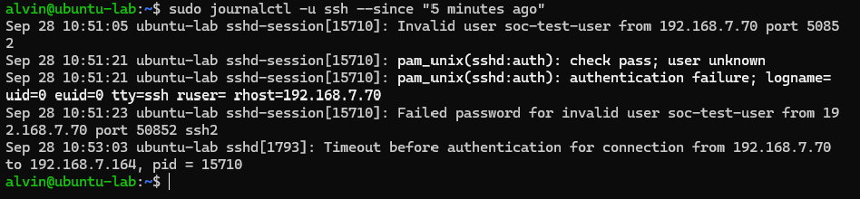
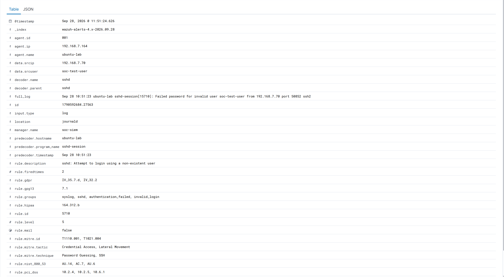

# Investigation 01 - Invalid SSH Login Attempt

## Overview

For my first SOC investigation, I generated a controlled SSH authentication event against the monitored `ubuntu-lab` endpoint.

I deliberately attempted to authenticate using a username that did not exist.

My objective was to test the complete detection workflow from the original Linux log through to the Wazuh SIEM alert.

I wanted to confirm that:

1. the Linux endpoint generated the expected authentication logs;
2. the Wazuh Agent collected the event;
3. Wazuh correctly detected the activity;
4. I could investigate and classify the alert using a SOC-style workflow.

## Scenario

I initiated an SSH connection from `soc-siem` to `ubuntu-lab`.

I used the deliberately invalid username:

```text
soc-test-user
```

I then entered an incorrect test password.

I did not use any real user credentials during this test.

## Environment

| Component | Value |
|---|---|
| SIEM | Wazuh |
| Source Host | `soc-siem` |
| Source IP | `192.168.7.70` |
| Target Host | `ubuntu-lab` |
| Target IP | `192.168.7.164` |
| Service | SSH |
| Log Source | journald |
| Wazuh Agent ID | `001` |

## Generating the Event

I generated the authentication attempt using:

```bash
ssh soc-test-user@192.168.7.164
```

Because `soc-test-user` does not exist on the destination system, the authentication attempt failed.

## Raw Endpoint Investigation

I reviewed the SSH logs directly on `ubuntu-lab` using:

```bash
sudo journalctl -u ssh --since "5 minutes ago"
```

The endpoint recorded several relevant events.

Important entries included:

```text
Invalid user soc-test-user from 192.168.7.70
```

```text
pam_unix(sshd:auth): authentication failure
```

```text
Failed password for invalid user soc-test-user from 192.168.7.70
```

From these logs, I could confirm that:

- an SSH connection reached the endpoint;
- the username did not exist;
- authentication failed;
- the source IP was `192.168.7.70`.

## Raw Log Evidence



## Wazuh Detection

I then searched for the same activity in Wazuh.

Wazuh generated the following alert:

| Field | Value |
|---|---|
| Rule ID | `5710` |
| Rule Level | `5` |
| Rule Description | `sshd: Attempt to login using a non-existent user` |
| Agent | `ubuntu-lab` |
| Agent ID | `001` |
| Agent IP | `192.168.7.164` |
| Source IP | `192.168.7.70` |
| Source User | `soc-test-user` |
| Decoder | `sshd` |
| Log Source | `journald` |

## SIEM Evidence



The Wazuh event also contained the original authentication log:

```text
Failed password for invalid user soc-test-user from 192.168.7.70
```

This allowed me to correlate the central SIEM alert with the original host telemetry.

## Event Correlation

I traced the event through the following path:

```text
soc-siem
192.168.7.70
     |
     | SSH login attempt
     |
     v
ubuntu-lab
192.168.7.164
     |
     | sshd generates authentication log
     |
     v
Linux journald
     |
     | Wazuh Agent collects event
     |
     v
Wazuh Manager
     |
     | Rule 5710 triggered
     |
     v
Wazuh Dashboard
```

This demonstrated the complete detection pipeline from activity generation to centralised SIEM analysis.

## MITRE ATT&CK Mapping

Wazuh mapped the event to the following MITRE ATT&CK techniques:

| Technique | Description |
|---|---|
| `T1110.001` | Password Guessing |
| `T1021.004` | SSH |

The associated tactics included:

```text
Credential Access
Lateral Movement
```

I treated these mappings as context for the observed behaviour rather than proof that malicious lateral movement had occurred.

MITRE ATT&CK mappings describe techniques associated with behaviour, but I still needed to investigate the event before determining its intent.

## My Investigation Process

I investigated the alert using the following workflow:

```text
Alert Generated
      |
      v
Identify affected endpoint
      |
      v
Identify source IP
      |
      v
Identify attempted username
      |
      v
Review raw SSH logs
      |
      v
Correlate host logs with SIEM event
      |
      v
Review Wazuh rule
      |
      v
Review MITRE ATT&CK mapping
      |
      v
Identify source system
      |
      v
Determine event disposition
```

## Source Identification

The source IP was:

```text
192.168.7.70
```

I identified this address as my own:

```text
soc-siem
```

server.

Because I had deliberately used this system to generate the test event, I knew the activity was authorised.

## Alert Classification

I classified the alert as:

**True Positive — Benign / Authorised Security Test**

I considered it a true positive because the behaviour detected by Wazuh genuinely occurred.

An SSH authentication attempt using a non-existent account was made against the monitored endpoint.

However, after investigating the source and context, I confirmed that the activity was intentionally generated inside my lab.

## Why I Did Not Classify It as a False Positive

A false positive would mean the detection incorrectly represented the activity that occurred.

In this case:

```text
Detection:
SSH authentication using a non-existent account

Actual activity:
SSH authentication using a non-existent account
```

The detection was therefore accurate.

The investigation was necessary to determine whether that correctly detected behaviour was malicious or authorised.

## How I Would Investigate This in Production

If I encountered the same alert unexpectedly in a production environment, I would continue the investigation by:

1. identifying whether the source IP belonged to an authorised system;
2. searching for additional failed authentication attempts from the same source;
3. checking whether multiple usernames had been targeted;
4. looking for successful SSH logins following the failed attempts;
5. reviewing other activity from the source endpoint;
6. reviewing activity on the destination endpoint;
7. checking whether the source had attempted to access other systems;
8. confirming whether the destination normally accepts SSH connections;
9. determining whether the activity suggested password guessing or attempted lateral movement;
10. escalating or containing the source if malicious activity was confirmed.

## Potential Remediation

If I confirmed malicious SSH activity, possible response actions could include:

- blocking the malicious source;
- disabling compromised accounts;
- requiring SSH key authentication;
- disabling unnecessary SSH access;
- restricting SSH access using firewall rules;
- disabling direct root SSH login;
- implementing account lockout controls;
- monitoring repeated authentication failures;
- reviewing successful logins that followed failed attempts.

## What I Learned

This investigation showed me that a SIEM alert does not automatically mean that an attack has occurred.

Wazuh correctly detected potentially suspicious authentication behaviour, but I still needed to investigate:

- the source IP;
- the target endpoint;
- the attempted username;
- the raw Linux logs;
- the detection rule;
- the MITRE ATT&CK mapping;
- the context of the activity.

Only after reviewing that information could I correctly classify the alert.

## Skills Demonstrated

Through this investigation, I practised:

- SOC alert triage;
- Wazuh SIEM analysis;
- Linux authentication log analysis;
- SSH monitoring;
- journald analysis;
- event correlation;
- source IP investigation;
- MITRE ATT&CK interpretation;
- true-positive classification;
- incident investigation;
- technical documentation.
