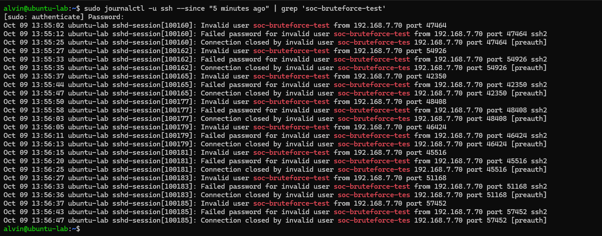
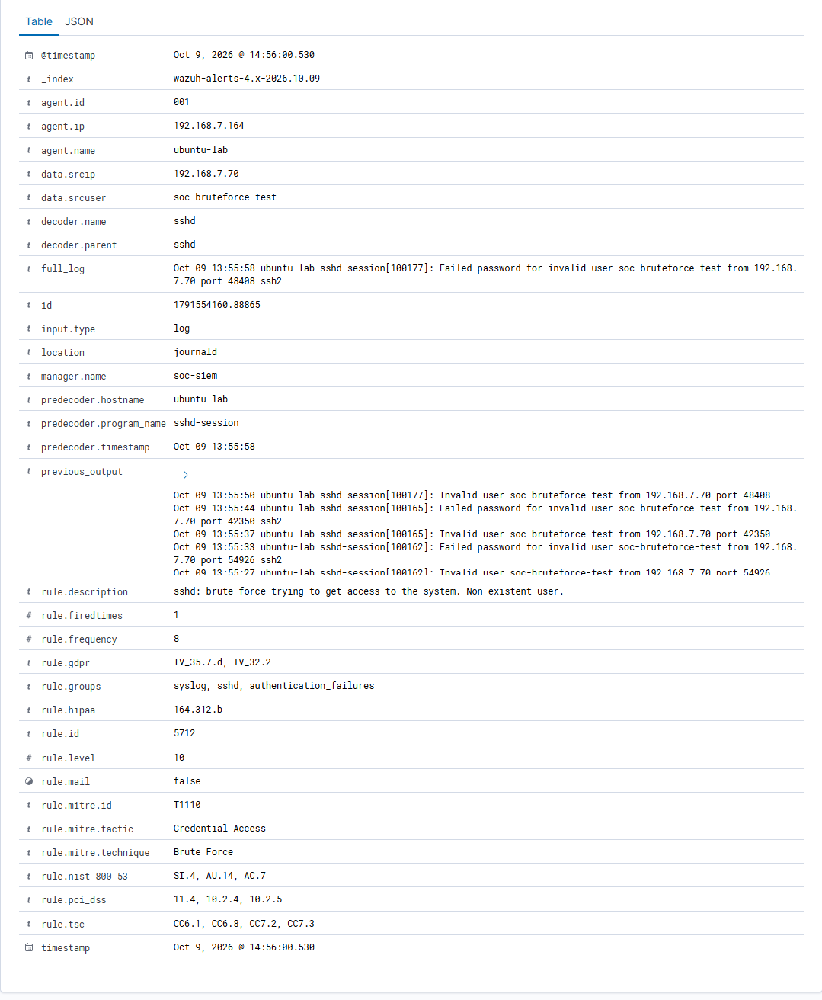

# Investigation 02 - Repeated SSH Authentication Failures

## Overview

For my second SOC investigation, I wanted to understand how Wazuh correlates multiple authentication events rather than only detecting a single failed login.

I generated repeated SSH authentication failures against my monitored `ubuntu-lab` endpoint using a deliberately non-existent account.

My objective was to observe the difference between individual failed authentication alerts and a higher-severity correlated brute-force alert.

## Environment

| Component | Value |
|---|---|
| SIEM | Wazuh |
| Source Host | `soc-siem` |
| Source IP | `192.168.7.70` |
| Target Host | `ubuntu-lab` |
| Target IP | `192.168.7.164` |
| Test Username | `soc-bruteforce-test` |
| Service | SSH |
| Log Source | journald |
| Wazuh Agent | `001` |

## Generating the Activity

I initiated repeated SSH authentication attempts from `soc-siem`:

```bash
ssh soc-bruteforce-test@192.168.7.164
```

The account `soc-bruteforce-test` deliberately does not exist on the target.

I used incorrect test passwords and did not use any real credentials.

## Raw Endpoint Evidence

I reviewed the SSH authentication logs on `ubuntu-lab` using:

```bash
sudo journalctl -u ssh --since "30 minutes ago" | grep 'soc-bruteforce-test'
```

The endpoint recorded repeated events including:

```text
Invalid user soc-bruteforce-test from 192.168.7.70
Failed password for invalid user soc-bruteforce-test from 192.168.7.70
Connection closed by invalid user soc-bruteforce-test
```

Each SSH session generated multiple authentication-related log entries.



## Wazuh Correlation

I then investigated the resulting alerts in Wazuh.

Wazuh generated a higher-severity correlated alert with the following details:

| Field | Value |
|---|---|
| Rule ID | `5712` |
| Rule Level | `10` |
| Rule Frequency | `8` |
| Description | `sshd: brute force trying to get access to the system. Non existent user.` |
| Source IP | `192.168.7.70` |
| Source User | `soc-bruteforce-test` |
| Target Agent | `ubuntu-lab` |
| Decoder | `sshd` |
| Log Source | `journald` |



## Understanding the Correlation

An important part of this investigation was understanding what Wazuh's frequency value represented.

The alert contained:

```text
rule.frequency: 8
```

Initially, this could be interpreted as eight separate SSH connection attempts.

However, after analysing the raw events and the `previous_output` field, I found that the alert had already triggered after four SSH sessions.

Each connection produced multiple matching events:

```text
Invalid user
Failed password
```

The events leading to the correlated alert were:

```text
Invalid user
Failed password

Invalid user
Failed password

Invalid user
Failed password

Invalid user
Failed password
```

This produced eight matching authentication events.

Wazuh then generated rule `5712`.

This helped me understand that correlation rules operate on matching security events rather than simply counting the number of network connections I manually generated.

## Event Flow

I observed the following detection process:

```text
Repeated SSH Connections
          |
          v
   Linux sshd logs
          |
          v
      journald
          |
          v
     Wazuh Agent
          |
          v
Individual authentication events
          |
          v
   Wazuh correlation
     frequency = 8
          |
          v
      Rule 5712
      Level 10
          |
          v
   Brute-Force Alert
```

## Previous Output

The Wazuh alert contained a `previous_output` field.

This was particularly useful because it showed the authentication events that contributed to the correlation rule.

Instead of investigating only the final event, I could see the sequence of activity that caused Wazuh to escalate the detection.

This demonstrated how event correlation can provide more context than analysing individual alerts in isolation.

## MITRE ATT&CK Mapping

Wazuh mapped the correlated alert to:

| MITRE ID | Technique | Tactic |
|---|---|---|
| `T1110` | Brute Force | Credential Access |

The MITRE mapping provides context about behaviour commonly associated with attempts to obtain credentials through repeated authentication attempts.

In my lab, the activity was deliberately generated and did not represent a real attacker.

## Comparing Investigation 01 and Investigation 02

My first investigation focused on a single invalid SSH authentication event.

That generated:

```text
Rule: 5710
Level: 5
```

In this investigation, repeated matching authentication events caused Wazuh to generate:

```text
Rule: 5712
Level: 10
Frequency: 8
```

This demonstrated how repeated activity can result in a higher-severity correlated detection.

The progression was:

```text
Individual SSH Failure
        |
        v
     Rule 5710
      Level 5
        |
        | repeated matching events
        v
 Event Correlation
        |
        v
     Rule 5712
     Level 10
        |
        v
  Brute-Force Alert
```

## My Investigation Process

I investigated the alert by:

1. reviewing the affected endpoint;
2. identifying the source IP;
3. identifying the attempted username;
4. reviewing the raw SSH logs;
5. checking the sequence and timestamps of authentication failures;
6. reviewing the Wazuh `previous_output` field;
7. identifying the correlation frequency;
8. reviewing the rule severity;
9. reviewing the MITRE ATT&CK mapping;
10. confirming ownership of the source system.

## Source Identification

The source IP was:

```text
192.168.7.70
```

I identified this as my `soc-siem` server.

Because I deliberately generated the activity from this server, I confirmed that the event was authorised lab testing.

## Classification

I classified the alert as:

**True Positive — Benign / Authorised Security Test**

The brute-force detection was a true positive because the repeated failed authentication behaviour genuinely occurred.

However, the investigation confirmed that I intentionally generated the activity as part of my SOC lab.

## How I Would Investigate This in Production

If I encountered a similar alert in a production SOC, I would investigate the source IP and determine whether it belonged to an authorised system.

I would search for other authentication failures from the same source and determine whether additional usernames or endpoints had been targeted.

I would also search for successful authentication following the failures because this could indicate that password guessing eventually succeeded.

I would review activity on both the source and destination systems and check whether the source had attempted authentication against other systems.

If I confirmed malicious activity, I would escalate the incident and consider containment actions such as blocking the source and securing potentially affected accounts.

## What I Learned

This investigation helped me understand the difference between individual detections and correlated security alerts.

Rather than treating each failed authentication event independently, Wazuh was able to recognise a pattern of repeated activity and generate a higher-severity alert.

I also learned that the `frequency` value in a correlation rule refers to matching events, which does not necessarily equal the number of individual network connections.

Reviewing the `previous_output` field was especially useful because it showed the events that contributed to the correlation.

## Skills Demonstrated

Through this investigation, I practised:

- SIEM event correlation
- Wazuh Threat Hunting
- Linux authentication analysis
- SSH monitoring
- brute-force detection
- temporal event analysis
- alert severity interpretation
- MITRE ATT&CK mapping
- raw log correlation
- SOC alert triage
- incident classification
- technical documentation
